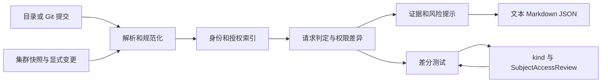

# Kubernetes 权限变更评审工具设计文档

文档版本为 0.6，更新日期为 2026-11-20。项目名称为 **GrantDiff**，命令名为 `grantdiff`，Go 模块路径为 `github.com/jintilm/GrantDiff`。

本文给出产品设计、技术约定和稳定版本验收条件。当前进入 `1.0.0-rc.1` 候选稳定版，实际使用接口见 README，实际测试结果见 `docs/validation.md`，报告结构见 `docs/report.schema.json`。候选支持范围与格式兼容性约定见 `docs/compatibility.md`。下述验收条件继续作为正式稳定版的目标。

当前实现使用 Go 标准库 `flag`、主体绑定索引和请求等价类比较。支持目录、Git、快照、候选变更、CRD 目录生成与三种报告格式。文本和 Markdown 提供按身份汇总的摘要，Markdown 详细证据可以展开。默认逐项输出请求等价类，`--compact` 可合并授权结论、风险及证据相同的兼容范围。YAML 输入限制采用固定安全上限并要求预先展开别名。聚合计算统一采用无环依赖稳定状态，快照查询同样使用此语义。项目许可证已采用 Apache-2.0。

**产品面向需要评审 Kubernetes 权限变更的开发者、安全工程师和平台工程师。**

用户提供变更前后的权限配置，工具计算受影响身份的授权变化，展示每项授权来自哪条绑定和哪个角色，并生成适合终端阅读、代码评审和自动化处理的报告。

项目应回答以下问题。

- 本次变更让哪些身份获得或失去了什么权限。
- 删除某条绑定后，哪些权限仍通过其他路径获得。
- 一个共享角色的修改会影响哪些绑定、身份和命名空间。
- 判断依据位于哪个文件、哪个对象和哪条规则。
- 哪些判断受输入缺失、身份组信息或计算范围影响，需要补充材料。

求职展示围绕权限语义、可解释分析、真实集群对照和跨平台交付展开。开源使用者可以直接运行程序，也可以贡献能重现授权边界情况的测试案例。

**稳定版的范围以 Kubernetes 原生 RBAC 为中心。**

| 设计项 | v1.0 的交付约定 |
| --- | --- |
| 运行方式 | 本地 CLI，提供 Windows 和 Linux 的独立可执行文件 |
| 核心输入 | 已渲染的 YAML 或 JSON，支持多文档文件和 Kubernetes List |
| 权限对象 | `rbac.authorization.k8s.io/v1` 的 Role、ClusterRole、RoleBinding、ClusterRoleBinding |
| 身份输入 | User、Group、ServiceAccount，以及显式提供的用户组成员关系 |
| 评审功能 | 有效授权差异、授权路径、路径变化后仍保留的权限、配置有效性诊断 |
| 规则覆盖 | API group、资源、子资源、命名空间、动词、对象名称限制、合法通配匹配、非资源 URL |
| 聚合角色 | 标签选择器和无环聚合依赖的稳定状态计算，循环依赖产生明确的不确定诊断 |
| 工程集成 | 本地目录、Git 两个提交、集群快照、基于快照的显式候选变更 |
| 输出 | 终端文本、Markdown、带版本的 JSON |
| 持续集成 | 可直接运行的命令和 GitHub Actions 示例，报告上传为构建产物及任务摘要 |
| 正确性验证 | 固定版本 kind 集群、SubjectAccessReview 对照、实际请求边界案例 |
| 发布 | 二进制包、校验和、版本说明、兼容性记录、可重现演示 |

Helm 和 Kustomize 项目通过各自工具导出完整清单后接入。分析报告定位到渲染后的文件，来源映射可以作为后续增强。对云 IAM、外部身份平台、其他授权器以及操作系统文件权限的分析，需要分别设计适配器和测试基准。Linux 文件权限与 Windows ACL 属于独立扩展方向。

Kubernetes 会在身份认证之后执行授权，并在授权通过后执行准入控制。本文定义的结论是给定身份和配置下的原生 RBAC 授权结果。用户请求能否最终完成还取决于其他授权器、准入规则、对象状态及服务可用性。报告必须带上授权模型和输入范围。[Kubernetes 授权文档](https://kubernetes.io/docs/reference/access-authn-authz/authorization/)

**Windows 和 Linux 采用同一套核心实现，并分别接受运行测试。**

| 平台 | 计划支持级别 | 运行评审工具 | 运行集群对照测试 |
| --- | --- | --- | --- |
| Windows 11 x86-64 | v1.0 正式支持目标 | 原生 `.exe` | Docker Linux 容器引擎和 kind |
| Linux x86-64 | v1.0 正式支持目标，以 Ubuntu 24.04 为验收环境 | 原生二进制 | Docker 和 kind |
| Linux ARM64 | 后续候选平台 | 发布对应架构构建后验证 | 需要 ARM64 环境和匹配的节点镜像 |
| macOS Intel / Apple Silicon | 后续候选平台 | 发布对应架构构建后验证 | 需要对应 macOS 运行环境 |
| Windows ARM64 | 后续候选平台 | 发布对应架构构建后验证 | 单独验证容器环境兼容性 |

Linux 发行版兼容性记录到具体测试环境。新平台达到相同验收标准后升级为正式支持。Go 支持按操作系统和架构构建程序，kind 提供多个平台的发行文件。[Go 平台文档](https://go.dev/doc/install/source#environment) [kind 快速入门](https://kind.sigs.k8s.io/docs/user/quick-start/)

离线评审的运行依赖是工具本身和输入文件。Git 提交评审需要 Git。集群快照需要可访问的 Kubernetes API 和相应读取权限。开发者执行集成测试时再准备 Docker 和 kind。

核心包使用 Go 标准库处理文件路径、临时目录、编码和进程。外部命令通过参数数组启动。文件内容按 UTF-8 读取，兼容 BOM、LF 和 CRLF。报告中的源文件路径统一表示为输入根目录内的相对路径，结构化结果按稳定顺序排序。

交付以 `CGO_ENABLED=0` 构建为目标，依赖选择必须维持这一条件。两端的命令参数、退出码和 JSON 语义相同，原生路径显示与启动方式遵循所在平台。Windows `.exe` 在 Windows 执行，Linux 二进制在 Linux 容器或 WSL2 内执行。每个正式发布平台均须有实际运行记录。

**输入必须能够重建评审范围内的完整权限状态。**

| 输入 | 内容 | 用途 |
| --- | --- | --- |
| before / after | 两套完整的已渲染权限对象 | 计算目标状态之间的差异 |
| identities | 用户名、组、ServiceAccount 身份以及成员关系完整性声明 | 确定授权作用于谁 |
| catalog | API group、资源、子资源、资源作用域、来源版本 | 区分命名空间资源、集群资源及可用于实际验证的请求 |
| snapshot metadata | 来源、范围、采集时间、各资源列表版本、内容摘要 | 追踪分析依据和发现快照变化 |
| changes | 对完整基线执行的显式 upsert / delete 操作及前置摘要 | 从已知状态构造候选状态 |

目录输入默认只声明该目录中对象构成的评审范围。使用者可提供完整集群快照，扩大到快照覆盖的范围。清单完整性声明必须进入报告，工具对声明和能够检测到的缺失分别记录。

Git 模式解析 base 和 head 两个提交中指定路径下的完整文件树。未修改文件中的角色和绑定同样参与计算。Git 对象通过明确提交 ID 读取，保留工作区现状。清单目录中的文件移除表示对象在该目录所描述的目标状态中移除。

集群快照包含全部可读取的 RBAC 对象、Namespace、ServiceAccount 和 API discovery 信息。采集发生在一个时间区间内，各资源种类的列表记录各自版本。报告说明跨种类读取的一致性依据，资源读取失败或采集中检测到相关变化时标记不完整，并允许重新采集。稳定测试环境通过多次读取内容一致来确认基线。

RC 新生成的快照采用 Schema 1.1，在 metadata 中保存 `rbac.json` 和 `catalog.json` 完整文件的 SHA-256。读取时先校验同一份文件字节，再解析 RBAC、身份、命名空间和目录。旧版 Schema 1.0 仍接受原有 RBAC 对象摘要校验，其身份与目录信息依赖可信输入来源。候选变化清单保留 Schema 1.0 的 RBAC 基线摘要约定。

将仓库变更应用到集群基线时，使用显式变化清单。清单列出被管理对象的完整键、upsert 后对象或 delete 动作，并可附变更前对象摘要。未列出的基线对象继续参与计算。删除依据来自 before 与 after 的对象差异，避免把仓库覆盖范围之外的对象推断为删除。摘要不匹配时返回基线过期诊断。

对象的唯一键为 `(kind, namespace, name)`。Role 与 RoleBinding 的命名空间必须在渲染结果中明确，或由用户显式指定的默认命名空间补足。ClusterRole 与 ClusterRoleBinding 使用集群作用域。一个输入状态中出现重复对象键时返回错误，并列出所有来源位置。

有效的非 RBAC 对象按类型记录读取情况。Namespace、ServiceAccount 和 CRD 元数据可补充身份及资源目录，其余对象只记录类型和位置。RBAC 字段错误、损坏的文档和无法识别的 RBAC API 版本均产生诊断。创建首批权限对象时可以用 `--allow-empty-before` 声明空基线，删除全部权限对象时使用 `--allow-empty-after`。其他未找到目标对象的情况返回输入诊断。

资源目录记录每个资源的 API group、规范名称、命名空间作用域、已知子资源和来源版本。目录来自随版本固定的测试样例、显式文件或集群快照。未知资源保留其符号授权范围，需要资源作用域才能判断的具体请求标记为 `unknown`。身份文件中的 `id` 是 CLI 选择身份的稳定标识。

```yaml
schemaVersion: "1.0"
identities:
  - id: report-bot
    kind: ServiceAccount
    name: report-bot
    namespace: finance
  - id: alice
    kind: User
    name: alice@example.test
    authenticated: true
    groups:
      - finance-readers
    groupsComplete: true
```

**身份和权限结论使用可检查的数据模型。**

| 模型 | 必要信息 |
| --- | --- |
| PolicyObject | 对象唯一键、规范化规则、原文件及文档序号、规则位置 |
| Identity | 用户名、主体类型、ServiceAccount 命名空间、已知组、组信息完整性 |
| Request | 请求类型、动词、API group、资源、子资源、命名空间、对象名或 URL |
| Evidence | 主体匹配、绑定、角色、聚合来源和命中的规则 |
| Decision | `granted`、`not_granted` 或 `unknown`，附依据和输入范围 |
| Change | `added`、`removed`、`retained_via_other_path`、`path_changed` 或 `indeterminate` |
| ReviewReport | schema 版本、来源摘要、输入诊断、变化、风险提示、计算完整性 |

主体名称、组名和对象名保留大小写语义。普通用户的组成员关系由输入提供，Kubernetes RBAC 配置本身无法列出某个组的全部成员。工具可以直接报告“某组被授予什么权限”，展开到具体用户时需要 identities 中的成员关系。组授权变更在报告中标记为 `group_grant`，个人和 ServiceAccount 的有效授权变更标记为 `identity_access`。组的一条授权被移除后，已知成员仍需结合自己的其他授权路径独立计算。[Kubernetes RBAC 文档](https://kubernetes.io/docs/reference/access-authn-authz/rbac/)

对于已声明为通过认证的普通用户，身份解析加入 `system:authenticated`。ServiceAccount 规范化为 `system:serviceaccount:<namespace>:<name>`，加入 `system:serviceaccounts`、`system:serviceaccounts:<namespace>` 和 `system:authenticated`。匿名身份显式建模为 `system:anonymous` 和 `system:unauthenticated`。生成 SubjectAccessReview 时传递完全相同的用户和组。[Kubernetes 身份认证文档](https://kubernetes.io/docs/reference/access-authn-authz/authentication/)

结果语义如下。

| 结果 | 成立条件 |
| --- | --- |
| `granted` | 已找到一条确定适用的原生 RBAC 授权路径 |
| `not_granted` | 在声明完整的输入和身份范围内，所有适用路径均已检查，且均未授予该请求权限 |
| `unknown` | 缺失角色、身份组信息或相关规则语义，导致无法判定 |

一条确定授权路径足以得出 `granted`。对于存在解析缺失的主体，无法找到授权路径时使用 `unknown`。RBAC 授权器对未匹配的请求返回无意见，API server 再结合其他授权器决定最终结果，因此结构化报告将 `not_granted` 明确解释为评审范围内的 RBAC 结论。[Kubernetes RBAC 实现](https://github.com/kubernetes/kubernetes/blob/master/plugin/pkg/auth/authorizer/rbac/rbac.go)

完整性是单独的报告字段。输入完整性、身份完整性和计算是否完成分别记录。涉及缺失信息的变化标记为 `indeterminate`，已证实的授权证据仍可展示。

**权限引擎按 Kubernetes 请求语义计算授权。**

| 语义 | 实现与验收要求 |
| --- | --- |
| 多条授权路径 | 对匹配的角色规则取并集，任何一条路径授予即可通过 |
| RoleBinding | 只在绑定所属命名空间生效，可以引用同命名空间的 Role 或一个 ClusterRole |
| ClusterRoleBinding | 引用 ClusterRole，作用范围包括其规则覆盖的集群请求和命名空间请求 |
| 跨命名空间列表 | 单独建模空命名空间的跨命名空间请求，与某个命名空间内列表分别验证 |
| API group | 核心 API group 为 `""`，名称匹配与通配覆盖单独处理 |
| 资源与子资源 | `pods`、`pods/log`、`pods/exec` 分别匹配，支持上游定义的 `*/子资源` 匹配 |
| 动词 | 按请求动词匹配，包括 `bind`、`escalate`、`impersonate` 等特定检查使用的动词 |
| resourceNames | 空列表表示允许所有名称，非空列表按名称精确匹配 |
| 非资源 URL | 按精确路径或合法尾部通配前缀匹配，通过集群作用域授权路径评估 |
| 聚合角色 | 依据标签选择器收集规则，保留源角色证据，无环依赖按拓扑顺序计算 |
| 默认角色 | 使用输入快照或与测试版本匹配的默认角色基线 |
| roleRef 变更 | 比较目标状态，同时报告绑定重建要求 |

`resourceNames` 的匹配须结合实际请求生成的 name。普通资源的 create 和 deletecollection 缺少可用的目标名称约束，list/watch 的名称限制需要验证带 `metadata.name` 字段选择器的实际请求，子资源请求另设案例。程序级 Request 模型记录传入属性，集成测试负责核对 HTTP 请求到授权属性的转换。[Kubernetes RBAC 规则说明](https://kubernetes.io/docs/reference/access-authn-authz/rbac/) [请求授权属性](https://kubernetes.io/docs/reference/access-authn-authz/authorization/)

`resourceNames` 中的字符串按字面值匹配。资源匹配实现遵循 `*`、精确资源及 `*/subresource` 的规则，URL 按自身的尾部通配语义处理。实现依据在开发时固定到目标 Kubernetes 源码版本，并用集群差分测试验证。[Kubernetes 规则匹配实现](https://github.com/kubernetes/kubernetes/blob/master/pkg/apis/rbac/v1/evaluation_helpers.go)

聚合计算排除控制器会跳过的自引用。其他循环依赖可能受已有 `.rules` 状态和控制器执行影响，相关主体的候选结论标记为 `unknown`，并输出循环链。对无环聚合计算控制器稳定后的规则，在线快照保留采集到的实际规则用于现状查询，变更预测明确采用稳定状态语义。测试须等待实际聚合结果收敛后再查询。[ClusterRole 聚合控制器实现](https://github.com/kubernetes/kubernetes/blob/master/pkg/controller/clusterroleaggregation/clusterroleaggregation_controller.go)

**有效权限差异通过请求集合比较得到。**

处理流程为以下顺序。

1. 解析两套完整输入并验证对象键、引用和语法，记录缺失范围。
2. 在两边分别建立主体、绑定、角色及聚合依赖索引，合并直接和间接受影响的主体，包括角色标签变化带来的新选择关系。
3. 为每个主体构造变更前后的授权谓词，保持各字段之间的组合关系和全部证据路径。
4. 根据两边规则中出现的精确值、通配范围和 URL 前缀边界划分请求等价类。
5. 逐类比较两边授权结果，合并授权结果及依据相同的相邻范围。
6. 输出权限增加、权限移除、经其他路径保留、路径变化和无法判定的部分。

每个维度除规则中出现的精确值外，还需表示“其他取值”的剩余范围。资源与子资源联合划分，命名空间区分命名空间内请求和集群范围请求，对象名保留空值类，URL 使用前缀边界划分。显式资源目录帮助生成有效请求和真实验证案例。超出当前目录的通配覆盖以符号范围显示，并标明其未来资源含义。

例如，变更前允许所有 ConfigMap 名称，变更后只允许 `billing-config`，报告应表达被移除的其余名称范围。示例名称可以用于解释，报告中的范围字段必须保留完整条件。

实现按受影响主体和作用域延迟生成等价类，利用索引和重复规则归并控制规模。首版设置明确的计算预算，建议默认每次评审最多比较 1,000,000 个等价类，并允许用户配置。预算耗尽返回 `incomplete` 和已完成范围，退出码反映未完成状态。性能预算是待测设计值。

`--compact` 在比较后按身份、变化类型、前后结论、风险及完整证据分组。一次只合并一个维度，其余维度必须相同。精确值可补回同组补集选择器的排除项，合并后的集合等于原集合的并集。URL 同时检查前缀和被排除的子前缀。两个孤立精确值继续分别表示，嵌套 URL 前缀也保留各自范围。算法按固定维度顺序重复到范围数稳定，输出使用 Schema 1.0 的现有字段。

合并保留一个原范围的代表请求，按最终范围重新计算变化 ID。摘要统计最终范围数，`comparedClasses` 记录比较阶段的等价类数。预算耗尽和输入不完整诊断继续保留。测试同时检查集合覆盖、证据位置、风险、确定性、幂等性和输入对象未被修改。

`retained_via_other_path` 要求某个已撤销的证据路径原本授予该权限，而变更后仍有其他路径授予。路径比较使用对象键和规则语义标识，源文件行号仅用于定位。规则重排会更新定位，冗余路径移除会产生路径变化说明，权限增加或移除数量按语义结果计算。

**实现以 Go CLI、可测试核心包和独立验证工具组成。**



| 模块 | 职责 | 主要依赖 |
| --- | --- | --- |
| CLI | 参数验证、输入组合、退出码和报告输出 | Go 标准库 `flag` |
| Input | YAML / JSON、Git 对象、位置记录、重复键检查 | YAML 节点解析、Kubernetes 类型 |
| Model | 规范化对象、主体、请求和结果 | `k8s.io/api`、`k8s.io/apimachinery` |
| Evaluate | 规则匹配、引用解析、聚合规则和证据 | 核心模型 |
| Diff | 受影响范围、等价类和语义差异 | Evaluate |
| Report | 文本、Markdown、JSON 与风险规则 | 稳定报告模型 |
| Cluster | 快照和验证 API 访问 | `k8s.io/client-go` |
| Integration | kind 生命周期、基线、请求样本和对照结果 | 固定版本测试工具 |

数据量首先通过内存索引处理。核心包接受结构化输入并返回结果，可在单元测试中直接调用。解释路径记录为对象引用和来源位置，避免依赖数据库才能运行。客户端库负责 Kubernetes API 调用，权限匹配和差异计算是项目自身实现的重要部分。[client-go 官方仓库](https://github.com/kubernetes/client-go)

建议仓库结构如下。它描述开发阶段的目标目录。

```text
cmd/grantdiff/
internal/input/
internal/model/
internal/evaluate/
internal/diff/
internal/report/
internal/cluster/
testdata/
integration/
examples/
docs/
.github/workflows/
go.mod
go.sum
README.md
CONTRIBUTING.md
LICENSE
```

Go 工具链、Kubernetes 依赖和 kind 版本在首次实现时固定。v1.0 的 Kubernetes 对照矩阵要求覆盖三个已发布次版本，并为每个版本记录精确补丁号和 kind 节点镜像摘要。具体版本取自实施时可获取且通过测试的镜像，发布记录列出实际通过结果。[kind 节点镜像选择](https://kind.sigs.k8s.io/docs/user/quick-start/)

**CLI 以可组合命令提供评审入口。**

以下命令为接口设计，路径对应未来随项目发布的样例。安装到 PATH 后，Windows 和 Linux 使用相同命令。直接运行当前目录中的程序时分别使用 `./grantdiff.exe` 和 `./grantdiff`。

```text
grantdiff diff --before ./examples/retained/before --after ./examples/retained/after --identities ./examples/retained/identities.yaml --catalog ./examples/retained/catalog.yaml --format markdown --output ./report.md

grantdiff query --input ./examples/retained/after --identities ./examples/retained/identities.yaml --catalog ./examples/retained/catalog.yaml --identity report-bot --namespace finance --resource configmaps --name billing-config --verb get

grantdiff diff --repo . --base BASE_COMMIT --head HEAD_COMMIT --path deploy/rbac --identities ./identities.yaml --catalog ./catalog.yaml --format json

grantdiff snapshot --context kind-grantdiff --output ./snapshot

grantdiff diff --baseline ./snapshot --changes ./changes.yaml --identities ./identities.yaml --format markdown
```

`diff` 的三种输入组合互斥。报告写入 stdout 或 `--output`，诊断写入 stderr。stdout 输出 JSON 时保持单一有效 JSON 文档。输出文件通过临时文件和最终替换写入，失败时保留可识别的错误状态，防止半份报告被当作成功产物读取。

退出码为拟定的稳定接口。

| 退出码 | 含义 |
| --- | --- |
| 0 | 已完成评审，符合调用方配置的通过条件 |
| 1 | 已完成评审，触发调用方选择的失败条件，例如 `--fail-on added` 或 `--fail-on high` |
| 2 | 参数、语法、文件读取或对象有效性错误 |
| 3 | 输入、身份信息或计算过程不完整，需要补充后才能完成指定范围评审 |
| 4 | 快照采集、集群验证或外部工具执行失败 |

默认评审在计算完整时返回 0，权限变化通过报告显示。CI 可以显式启用 `--fail-on`。当错误、未完成和风险提示同时出现时，按 4、2、3、1 的顺序选取进程退出码，所有诊断继续保存在报告中。`query` 通过结构化结果表达授权结论，进程退出码沿用命令是否完成的语义。

RC 风险规则覆盖新增 Secret 读取权限、RBAC bind/escalate 以及身份模拟权限。跨命名空间和通配授权通过报告范围表达。每条提示包含规则 ID、命中范围、证据和前置条件。对 `bind`、`escalate`、`impersonate` 的解释须结合相关对象限制，攻击链可行性需要专门验证。

**演示案例展示移除直接绑定后仍保留权限的原因。**

| 对象 | 变更前 | 变更后 |
| --- | --- | --- |
| Role `finance/report-reader` | 允许 get ConfigMap `billing-config` | 同样授予该权限 |
| RoleBinding `finance/direct-read` | 将角色授予 ServiceAccount `finance/report-bot` | 删除 |
| RoleBinding `finance/group-read` | 将同一角色授予 Group `system:serviceaccounts:finance` | 同样存在 |

`report-bot` 属于 `system:serviceaccounts:finance`，因此两边对该请求都返回 `granted`。报告展示直接路径已移除，以及仍适用的组授权路径。

```text
评审范围    examples/retained 中的完整输入
主体        system:serviceaccount:finance:report-bot
请求        get configmaps/billing-config，命名空间 finance
结果        retained_via_other_path

剩余路径
ServiceAccount finance/report-bot
  → Group system:serviceaccounts:finance
  → RoleBinding finance/group-read
  → Role finance/report-reader
  → get configmaps，名称 billing-config

建议核对    若意图是收回 report-bot 的权限，需检查 group-read 覆盖的成员与其他业务需求
```

JSON 报告结构示意如下，开发阶段将提供 JSON Schema 和完整示例。

```json
{
  "schemaVersion": "1.0",
  "authorizationModel": "kubernetes-rbac",
  "scope": {
    "source": "repository",
    "identityCompleteness": "complete",
    "policyCompleteness": "declared_complete",
    "calculation": "complete"
  },
  "changes": [
    {
      "targetType": "identity_access",
      "type": "retained_via_other_path",
      "subject": "system:serviceaccount:finance:report-bot",
      "request": {
        "verb": "get",
        "apiGroup": "",
        "resource": "configmaps",
        "namespace": "finance",
        "name": "billing-config"
      },
      "before": "granted",
      "after": "granted",
      "afterEvidence": [
        {
          "group": "system:serviceaccounts:finance",
          "binding": "RoleBinding/finance/group-read",
          "role": "Role/finance/report-reader"
        }
      ]
    }
  ],
  "diagnostics": []
}
```

正式报告还需要来源摘要、变更前证据、规则定位、符号范围、风险项和统计。稳定变化 ID 根据主体、授权范围和变化类型生成，规则重排或文件换行变化不会改变其语义标识。

**验证使用 Kubernetes API 的结果作为独立对照。**

单元测试覆盖解析、身份展开、匹配规则、证据路径和差异合并。重点设置能暴露错误结论的案例，例如删除直接绑定但组绑定仍生效、通配规则收窄、同名角色位于不同命名空间、引用缺失和聚合标签变更。

集成测试由测试程序创建带唯一名称的 kind 环境。测试程序记录自己创建的集群、配置和临时目录，只清理此次测试拥有的资源。验证所需管理员凭据留在测试进程内。

每个测试场景按以下顺序执行。

1. 固定 Kubernetes 版本、API server 授权配置、默认 RBAC 对象和资源目录，记录默认授权基线。
2. 为 before 创建干净状态，载入测试对象，等待 API 可用和聚合规则稳定。
3. 将默认对象与场景对象共同输入工具，针对指定身份及完整组集合生成请求。
4. 通过 `authorization.k8s.io/v1` 的 SubjectAccessReview 比较每个请求的授权结果。测试查询客户端拥有创建评审请求所需的权限。
5. 在另一个干净状态中执行 after，比较两边实际授权变化与工具的变化报告。
6. 对涉及 list/watch 名称过滤、子资源及额外权限检查的案例，发送实际受控 API 请求补充验证。
7. 输出固定种子、输入对象、身份、请求和两端结果，允许单独重跑失败案例。

本机运行可以依次创建 before 和 after 环境，降低内存占用。默认绑定纳入两端基线，测试身份采用普通测试用户和 ServiceAccount。其他授权器或特权身份影响判断的案例单独标记模型范围。SubjectAccessReview 的 `status.evaluationError`、客户端失败或环境状态异常均归为验证失败，失败记录附相应原因。

| 验证范围 | v1.0 验收条件 |
| --- | --- |
| 确定性案例 | 每项已声明支持的语义均有正例和反例，所有指定请求与固定测试集群一致 |
| 组合案例 | 固定种子生成有效角色、绑定和请求，发布实际查询数量、失败数量和复现种子 |
| 不完整输入 | 缺失角色、缺失组信息、循环聚合和预算耗尽均得到明确诊断与对应退出码 |
| 跨系统结果 | 同一输入在 Windows 和 Linux 上产生一致的规范化 JSON，定位信息与源文件一致 |
| 文件处理 | 中文和空格路径、CRLF/LF、BOM、只读输入目录和无效文件均有运行记录 |
| 版本兼容 | 三个目标 Kubernetes 次版本分别通过完整对照集，并记录镜像摘要 |
| 发布包 | 在干净环境解压后运行示例和错误输入，校验版本信息、退出码和报告格式 |

性能测量采用固定生成器和数据种子，分别记录加载、索引、比较和输出耗时。建议基准包含 10,000 个权限对象、1,000 个身份及不同通配密度，并增加只修改少量对象的评审场景。初步目标为常见场景 10 秒内完成、分析进程峰值内存低于 512 MiB。实际结果须记录机器、工具版本、输入规模和计算预算，再决定发布承诺。

**输入处理与 CI 集成围绕仓库中的不可信配置设计。**

离线评审只解析输入数据。YAML 别名展开、文件数量、总字节数和嵌套深度设置可配置上限。符号链接及目录联接须验证解析后的目标仍在声明输入根目录内。模板渲染由调用方独立执行，集成文档说明其权限环境。

`snapshot` 通过用户指定的 kubeconfig 和 context 读取对象，输出仅包含评审所需元数据。kubeconfig 可能配置外部凭据程序，因此快照命令只接受用户主动选择的可信配置来源。日志与报告保留 API 错误和对象位置，凭据通过客户端配置使用。

GitHub Actions 示例对外部 PR 使用受限读取权限执行评审，生成 Markdown、JSON 和任务摘要。调用项目固定版本，PR 中的配置作为数据输入。未来如增加自动评论，由独立的受限发布步骤验证报告结构、提交 ID 和目标 PR，使用完成评论所需的权限。[GitHub Actions 安全使用参考](https://docs.github.com/en/actions/security-for-github-actions/security-guides/security-hardening-for-github-actions)

**开发按可验证的能力逐步发布。**

| 阶段 | 交付内容 | 进入下一阶段的条件 |
| --- | --- | --- |
| v0.1 | 完整目录输入、四类对象、ServiceAccount 及其系统组匹配、query、精确请求的前后比较、文本和 JSON | 核心演示案例可运行，在包含默认角色的测试基线上通过本地 kind 对照 |
| v0.2 | 普通 User / Group 成员关系、通配和名称范围、子资源、非资源 URL、有效权限差异和证据 | 正反例、组合测试和缺失输入诊断通过 |
| v0.3 | 无环聚合、版本化默认角色基线、Git 两提交评审、Markdown、风险项 | Git 未修改文件参与计算，聚合变更和绑定重建案例通过 |
| v0.4 | 集群快照、显式候选变更、Windows / Linux 发布测试、CI 示例 | 基线过期诊断、运行平台一致性和外部 PR 样例通过 |
| v0.5 | CRD 目录、报告摘要、固定种子权限组合测试、上游案例 | 目录与 discovery 一致，摘要与完整结果一致，组合测试和案例报告可复现 |
| v0.6 | 可选范围合并、子资源请求边界、通配性能测量 | 合并前后覆盖及证据一致，三版本组合测试通过，记录报告体积和分阶段耗时 |
| v1.0 RC | 候选兼容性约定、完整快照校验、第二个上游案例、自动安装包验证 | 双平台解压运行、报告一致性和三版本 Kubernetes 检查通过，提供可下载候选包 |
| v1.0 | 三版本兼容矩阵、性能报告、稳定 JSON Schema、发布流程和开源文档 | 所有正式支持项满足验收表，公开可重跑的演示与已知限制 |

每阶段遇到尚未支持的语义时，返回对应诊断并标记受影响结论。阶段发布说明列出实际支持范围。进度由验收结果决定，开发周期在第一阶段完成后结合个人投入和测量结果估算。

本机开发优先使用一个 kind 环境串行运行，版本矩阵同样串行执行。此前读取到的本机条件约为 16 GiB 内存、16 个逻辑处理器和可连接的 Docker Linux 引擎，适合作为起步环境。镜像下载、构建缓存和集群运行的实际资源占用在第一阶段测量。

**开源交付应让陌生开发者复现结果并提交改进。**

v1.0 包含中英文使用说明、清晰的兼容性记录、示例输入与预期报告、单命令演示入口、贡献指南、缺陷复现模板、变更记录和发行包校验信息。贡献指南提供新增授权案例的路径，让贡献者能够从一个失败用例开始。

项目采用 Apache-2.0 许可证，相关依赖和引用代码保留各自要求的声明。仓库使用名称 GrantDiff。[项目仓库](https://github.com/jintilm/GrantDiff)

项目介绍可以展示“一个删除绑定后权限仍然存在的真实可复现案例”“多版本 Kubernetes 对照结果”和“Windows / Linux 同输入一致的报告”。这些材料由公开仓库的运行记录支撑，测量数据以实际结果填写。

**实施前已有明确默认方案，外部条件在对应阶段补齐。**

| 事项 | 本文采用的方案 | 补齐时间 |
| --- | --- | --- |
| 实现语言与形态 | Go CLI，独立核心包，原生程序发布 | 从 v0.1 开始 |
| 首要平台 | Windows 11 x86-64、Linux x86-64 | v0.1 开始验证，v0.4 完成发布流程 |
| 权限模型 | 原生 Kubernetes RBAC，报告带输入范围与完整性 | 从 v0.1 开始 |
| 软件版本 | 固定实施时使用的精确版本和镜像摘要 | v0.1 记录首个版本，v1.0 扩展为三个次版本 |
| 性能预算 | 先使用文中目标，测量后修订 | v0.2 开始记录，v1.0 发布实测 |
| 仓库名称与许可证 | GrantDiff，Apache-2.0 | 已确定 |
| ARM64 与 macOS | 满足完整运行验证后加入正式矩阵 | 后续迭代 |

完成 v1.0 的判断依据是本文的功能、运行平台和验证交付全部通过。每次增加新的授权语义、输入来源或正式支持平台，都同时补充复现案例和对应环境的验证记录。
